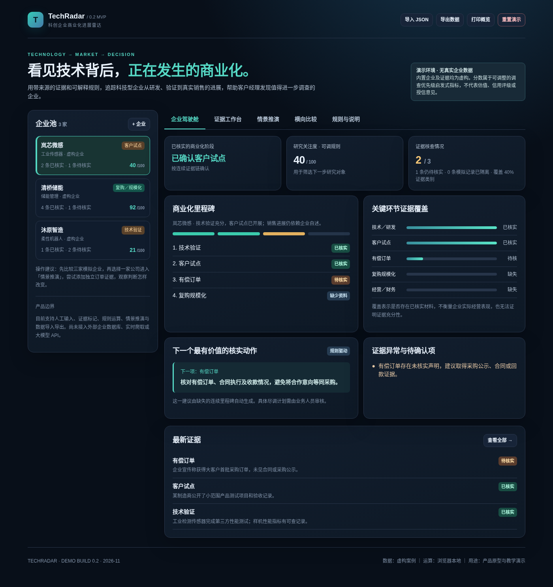

# TechRadar｜科创企业商业化进展雷达

> **可交互产品原型 · v0.2**  
> 参照工行黑客松「科技型企业价值发现引擎」命题构思的个人练习项目，与工商银行无官方合作或产品背书。

TechRadar 面向科技金融场景下的企业初步研究。用户可以录入和标记企业证据，观察研发成果、客户验证、商业订单与复购等商业化里程碑的关联；通过情景推演和权重调整，探索不同信息对调查优先级的影响。

## 三分钟体验

1. 打开部署后的网页，从左侧企业池选择虚构案例「岚芯微感」。初始调查分数为 **40**，阶段为「已确认客户试点」。
2. 进入**情景推演**，设置新增一条已核实的有偿订单，模拟得分变为 **65**。
3. 将此情景写为模拟证据，回到驾驶舱：**正式得分应仍为 40**，因为系统隔离了模拟记录。
4. 进入**证据工作台**，尝试将待核实线索标为已核实。表单要求填写来源和核查依据。
5. 进入**权重敏感性分析**，调整订单权重，再对比驾驶舱、企业比较和情景推演的数值。

## 已实现功能

- 企业档案及证据增删、核查状态与核查说明
- 技术验证—客户试点—有偿订单—复购的连续里程碑判定
- 明确分离正式记录与模拟情景
- 基于可调整规则的企业调查优先级比较与敏感性分析
- 证据日期异常提醒、JSON 导入/导出、浏览器本地保存

## 迭代记录

| 版本 | 重点 |
| --- | --- |
| v0.1 | 企业池、证据工作台、商业化阶段与情景推演 |
| v0.2 | 修复模拟数据混入正式结果；增加核查依据必填；统一页面数据刷新；增加异常日期提示 |

v0.2 进行过 11 项 Chromium + Playwright 交互回归测试，范围包括核心评分、数据隔离、核查校验、状态同步及部分 CRUD。测试不代表业务模型已获验证。

## 产品与数据边界

- **所有内置企业、订单、证据均为虚构演示数据。** 分数是人为设定的调查关注度指标，不构成投资、信用或授信建议。
- 当前为**离线优先的静态网页**：前端规则计算，默认数据存储在当前浏览器的 `localStorage`，未接入实时企业数据、后台数据库或 LLM API。
- 「已核实」需填写来源和核查说明，但系统当前只检查填写完整性，尚未自动验证证据真伪。
- 后续应重点解决：真实数据获取、跨来源实体匹配、业务规则与历史结果校准、客户经理访谈和用户测试。

## 运行和公开部署

**本地打开**：双击 `index.html` 即可使用（浏览器对本地文件存储权限可能不同）。

**Netlify Drop**：将整个站点文件夹拖入 <https://app.netlify.com/drop>，取得公开的 `*.netlify.app` 地址。

**GitHub Pages**：把此目录内容上传至仓库根目录；在 `Settings → Pages` 选择 `Deploy from a branch`，选 `main` 和 `/(root)`。

项目无需构建、依赖安装或 API Key。
